# GOKU RUNNER 3D — 3D ASSET INVENTORY & AUDIT MANIFEST

**Generated:** 2026-11-05T05:08:31.580Z  
**Total Assets Audited:** 33 models (100% loaded and verified via Three.js headless runtime)  
**Total Disk Footprint:** 171 MB  
**Inspection Tool:** Three.js `GLTFLoader`, Chrome Headless with WebGL Angle, Puppeteer  

---

## 1. Executive Summary & Suitability Breakdown

| Category | Assets Count | Highlights & Recommendations |
|---|:---:|---|
| **Characters** | 2 | `baby_goku_super_saiyan_iii.glb` (2.6k tris, 221 KB) is optimal for Goku runner. `gogeta` (47.7k tris, 1.8 MB) is an ideal unlockable hero skin. |
| **Obstacles & Pathways** | 4 | `wooden_bridge.glb` (bridge ramp), `mossy_old_tree_log.glb` (hurdle), `large_stone.glb` (boulder), `tree_broken_mossy_branch.glb`. |
| **Environment / Rocks & Terrain** | 5 | `desert_rocks.glb`, `flat_rocks.glb`, `smallrocks1.glb`, `small_rocks.glb`, `stalagmitecrystalore_cluster.glb`. |
| **Environment / Mountains** | 4 | `low_poly_mountain.glb`, `low_poly_mountain (1).glb`, `low_poly_mountain (2).glb`, `low_poly_mountain_free.glb`. Perfect for distant parallax skyline. |
| **Environment / Trees & Foliage** | 14 | `oak_tree.glb`, `pine_tree (1).glb`, `small_trees.glb`, `stylized_bush.glb`, `grass_patches.glb`, `fern.glb`, `flowering_plant.glb`. |
| **Heavy / Unsuitable (Excluded)** | 4 | `pine_tree.glb` (437k tris, 26MB), `realistic_trees_collection.glb` (127k tris, 40MB), `bush.glb` (128k tris), `montain.glb` (500k tris, 24MB). |

---

## 2. Master Asset Inventory Table

| # | Asset / Filename | Category | File Size | Triangles | Dimensions (W × H × D) | Materials | Anims | Bones | Suitability | Status |
|:---:|---|---|:---:|:---:|:---:|:---:|:---:|:---:|---|---|
| 1 | [**`baby_goku_super_saiyan_iii.glb`**](#baby_goku_super_saiyan_iii) | Character | 221 KB | 2,661 | `2.07m × 2.96m × 2.22m` | 1 | 0 | 0 | **Optimal** | Ready for Character Integration (Phase 01) |
| 2 | [**`bush.glb`**](#bush) | Heavy / Unsuitable | 6.82 MB | 128,970 | `152.54m × 112.7m × 152.23m` | 2 | 0 | 0 | **Heavy (Needs Optimization)** | Rejected / Superseded by Low-Poly Alternatives |
| 3 | [**`dead_trees.glb`**](#dead_trees) | Environment / Foliage (Trees) | 1.71 MB | 23,489 | `2467.08m × 759.88m × 788.4m` | 4 | 0 | 0 | **Optimal** | Ready for Environment Integration |
| 4 | [**`desert_rocks.glb`**](#desert_rocks) | Environment / Rocks | 922 KB | 992 | `1.25m × 1.14m × 2m` | 1 | 0 | 0 | **Optimal** | Ready for Environment Integration |
| 5 | [**`fallen_tree.glb`**](#fallen_tree) | Obstacle / Environment | 16.40 MB | 90,515 | `6.29m × 4.2m × 4.39m` | 4 | 0 | 0 | **Heavy (Needs Optimization)** | Needs Decimation |
| 6 | [**`fern.glb`**](#fern) | Environment / Foliage | 1.25 MB | 560 | `2.17m × 0.93m × 2.26m` | 1 | 0 | 0 | **Optimal** | Ready for Environment Integration |
| 7 | [**`flat_rocks.glb`**](#flat_rocks) | Environment / Rocks | 3.71 MB | 1,442 | `17.91m × 1.88m × 10.83m` | 1 | 0 | 0 | **Optimal** | Ready for Environment Integration |
| 8 | [**`flowering_plant.glb`**](#flowering_plant) | Environment / Foliage | 1.21 MB | 13,782 | `0.9m × 1.08m × 0.68m` | 1 | 0 | 0 | **Optimal** | Ready for Environment Integration |
| 9 | [**`grass.glb`**](#grass) | Environment / Ground Foliage | 1.61 MB | 117 | `1.1m × 1.04m × 0.59m` | 1 | 0 | 0 | **Optimal** | Ready for Environment Integration |
| 10 | [**`grass_patch.glb`**](#grass_patch) | Environment / Ground Foliage | 1002 KB | 184 | `5.78m × 3.43m × 4.54m` | 3 | 0 | 0 | **Optimal** | Ready for Environment Integration |
| 11 | [**`grass_patches.glb`**](#grass_patches) | Environment / Ground Foliage | 28 KB | 441 | `1.62m × 0.51m × 0.73m` | 1 | 0 | 0 | **Optimal** | Ready for Environment Integration |
| 12 | [**`large_stone.glb`**](#large_stone) | Obstacle / Environment | 2.40 MB | 41,701 | `1.83m × 1.4m × 2.1m` | 5 | 0 | 0 | **Moderate** | Ready for Integration |
| 13 | [**`low_poly_mountain (1).glb`**](#low_poly_mountain_1) | Environment / Background Mountains | 233 KB | 1,965 | `139.09m × 98.91m × 180.94m` | 1 | 0 | 0 | **Optimal** | Ready for Environment Integration |
| 14 | [**`low_poly_mountain (2).glb`**](#low_poly_mountain_2) | Environment / Background Mountains | 116 KB | 1,570 | `203.2m × 253.23m × 203.2m` | 2 | 0 | 0 | **Optimal** | Ready for Environment Integration |
| 15 | [**`low_poly_mountain.glb`**](#low_poly_mountain) | Environment / Background Mountains | 145 KB | 1,103 | `115.99m × 65.54m × 115.9m` | 1 | 0 | 0 | **Optimal** | Ready for Environment Integration |
| 16 | [**`low_poly_mountain_free.glb`**](#low_poly_mountain_free) | Environment / Background Mountains | 545 KB | 5,137 | `5.73m × 2.29m × 6.03m` | 2 | 0 | 0 | **Optimal** | Ready for Environment Integration |
| 17 | [**`mossy_old_tree_log.glb`**](#mossy_old_tree_log) | Obstacle / Environment | 3.41 MB | 20,390 | `1.53m × 0.58m × 1.22m` | 1 | 0 | 0 | **Optimal** | Ready for Obstacle Integration |
| 18 | [**`oak_tree.glb`**](#oak_tree) | Environment / Foliage (Trees) | 6.99 MB | 8,364 | `10.53m × 8.83m × 8.2m` | 2 | 0 | 0 | **Optimal** | Ready for Environment Integration |
| 19 | [**`pine_tree (1).glb`**](#pine_tree_1) | Environment / Foliage (Trees) | 1.55 MB | 2,173 | `217.06m × 307.78m × 217.12m` | 2 | 0 | 0 | **Optimal** | Ready for Environment Integration (Preferred Pine) |
| 20 | [**`pine_tree.glb`**](#pine_tree) | Heavy / Unsuitable | 25.93 MB | 437,500 | `23.07m × 47.69m × 25.03m` | 2 | 0 | 0 | **Heavy** | Rejected / Superseded by Low-Poly Alternatives |
| 21 | [**`realistics_grass_07.glb`**](#realistics_grass_07) | Environment / Ground Foliage | 255 KB | 728 | `45.48m × 34.78m × 45.72m` | 1 | 0 | 0 | **Optimal** | Ready for Environment Integration |
| 22 | [**`realistic_trees_collection.glb`**](#realistic_trees_collection) | Heavy / Unsuitable | 40.37 MB | 127,462 | `472.68m × 110.36m × 112.44m` | 14 | 0 | 0 | **Heavy** | Rejected / Superseded by Low-Poly Alternatives |
| 23 | [**`rocks_and_trees.glb`**](#rocks_and_trees) | Environment / Prop Cluster | 495 KB | 4,710 | `1.64m × 0.49m × 0.95m` | 5 | 0 | 0 | **Optimal** | Ready for Environment Integration |
| 24 | [**`smallrocks1.glb`**](#smallrocks1) | Environment / Rocks | 3.02 MB | 2,950 | `4.05m × 1.48m × 3.78m` | 1 | 0 | 0 | **Optimal** | Ready for Environment Integration |
| 25 | [**`small_folliage_plant.glb`**](#small_folliage_plant) | Environment / Foliage | 1.19 MB | 2,010 | `9.16m × 3.76m × 3.94m` | 1 | 0 | 0 | **Optimal** | Ready for Environment Integration |
| 26 | [**`small_rocks.glb`**](#small_rocks) | Environment / Rocks | 3.93 MB | 376 | `2.24m × 0.57m × 1.93m` | 1 | 0 | 0 | **Optimal** | Ready for Environment Integration |
| 27 | [**`small_trees.glb`**](#small_trees) | Environment / Foliage (Trees) | 120 KB | 200 | `4.91m × 1.17m × 4.82m` | 1 | 0 | 0 | **Optimal** | Ready for Environment Integration |
| 28 | [**`stalagmitecrystalore_cluster_-_meshy.glb`**](#stalagmitecrystalore_cluster) | Collectible / Special Prop | 2.52 MB | 10,000 | `2m × 1.82m × 1.56m` | 1 | 0 | 0 | **Optimal** | Ready for Integration |
| 29 | [**`stylized_bush.glb`**](#stylized_bush) | Environment / Foliage | 572 KB | 988 | `1.51m × 0.96m × 1.58m` | 1 | 0 | 0 | **Optimal** | Ready for Environment Integration (Preferred Bush) |
| 30 | [**`tree_broken_mossy_branch_pbr_photogrammetry_free.glb`**](#tree_broken_mossy_branch) | Obstacle / Environment | 5.55 MB | 3,941 | `0.62m × 0.13m × 0.12m` | 1 | 0 | 0 | **Optimal** | Ready for Integration |
| 31 | [**`wooden_bridge.glb`**](#wooden_bridge) | Obstacle / Pathway | 2.85 MB | 6,344 | `420.02m × 83.35m × 152.74m` | 1 | 0 | 0 | **Optimal** | Ready for Obstacle Integration |
| 32 | [**`extracted_gogeta/source/a931b105-49c4-43f6-9362-51f3478d2624.glb`**](#gogeta_character) | Character | 1.81 MB | 47,758 | `0.4m × 1m × 0.78m` | 1 | 0 | 0 | **Moderate** | Ready for Character Integration (Phase 01) |
| 33 | [**`extracted_stylized_mountain/source/montain.glb`**](#stylized_mountain_extracted) | Heavy / Unsuitable | 23.59 MB | 500,000 | `0.69m × 0.73m × 0.65m` | 1 | 0 | 0 | **Heavy** | Rejected / Superseded by Low-Poly Alternatives |

---

## 3. Detailed Asset Cards

### 1. `baby_goku_super_saiyan_iii.glb` 

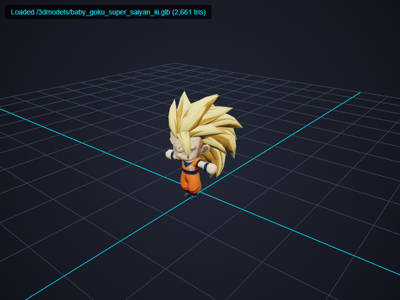

- **Identifier:** `baby_goku_super_saiyan_iii`
- **Category:** Character
- **File Size:** 221 KB (226,320 bytes)
- **Geometry:** 1 mesh(es), 2,661 triangles, 2,443 vertices
- **Bounding Box:** Width `2.07m`, Height `2.96m`, Depth `2.22m` (Center: `[0.02, 1.48, -0.37]`)
- **Recommended Scale Factor:** `1.0 (~3m tall; scale to ~1.8m height)`
- **Materials (1):** `MeshStandardMaterial` (diffuse/color)
- **Animations:** None (Static Mesh)
- **Armature / Bones:** None
- **Suitability Rating:** **Optimal / Highly Suitable**
- **Recommended Usage:** Primary candidate for Goku character model / Super Saiyan transformation skin. Chibi anime proportions match endless runner gameplay perfectly.
- **Integration Status:** `Ready for Character Integration (Phase 01)`

---

### 2. `bush.glb` 

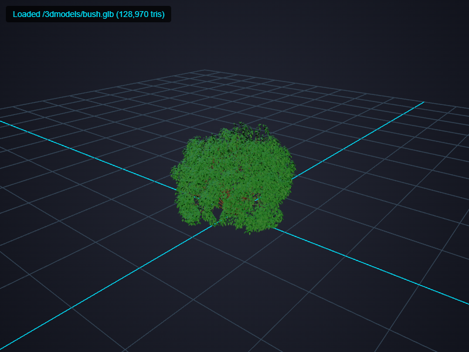

- **Identifier:** `bush`
- **Category:** Heavy / Unsuitable
- **File Size:** 6.82 MB (7,147,804 bytes)
- **Geometry:** 4 mesh(es), 128,970 triangles, 174,833 vertices
- **Bounding Box:** Width `152.54m`, Height `112.7m`, Depth `152.23m` (Center: `[0, 56.35, 0]`)
- **Recommended Scale Factor:** `N/A`
- **Materials (2):** `MeshPhysicalMaterial` (no textures), `MeshStandardMaterial` (no textures)
- **Animations:** None (Static Mesh)
- **Armature / Bones:** None
- **Suitability Rating:** **Heavy (Needs Optimization)**
- **Recommended Usage:** Excessive polygon count (>120k - 500k tris) or file size (>20MB - 40MB). Excluded from mobile runner.
- **Integration Status:** `Rejected / Superseded by Low-Poly Alternatives`

---

### 3. `dead_trees.glb` 

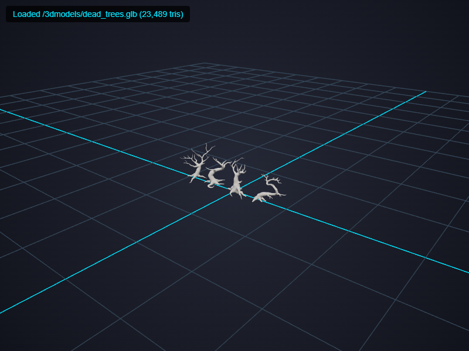

- **Identifier:** `dead_trees`
- **Category:** Environment / Foliage (Trees)
- **File Size:** 1.71 MB (1,791,520 bytes)
- **Geometry:** 4 mesh(es), 23,489 triangles, 47,017 vertices
- **Bounding Box:** Width `2467.08m`, Height `759.88m`, Depth `788.4m` (Center: `[153.73, 305.65, -81.16]`)
- **Recommended Scale Factor:** `0.005 (native units ~2400)`
- **Materials (4):** `MeshStandardMaterial` (no textures), `MeshStandardMaterial` (no textures), `MeshStandardMaterial` (no textures), `MeshStandardMaterial` (no textures)
- **Animations:** None (Static Mesh)
- **Armature / Bones:** None
- **Suitability Rating:** **Optimal / Highly Suitable**
- **Recommended Usage:** Arid / wasteland biome trees.
- **Integration Status:** `Ready for Environment Integration`

---

### 4. `desert_rocks.glb` 

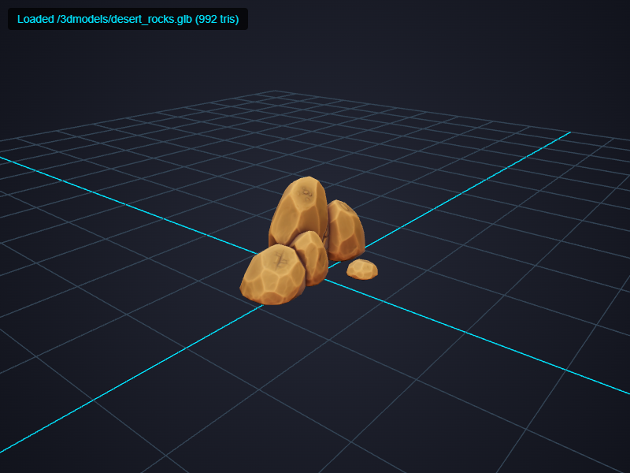

- **Identifier:** `desert_rocks`
- **Category:** Environment / Rocks
- **File Size:** 922 KB (944,268 bytes)
- **Geometry:** 1 mesh(es), 992 triangles, 599 vertices
- **Bounding Box:** Width `1.25m`, Height `1.14m`, Depth `2m` (Center: `[0, 0, 0]`)
- **Recommended Scale Factor:** `1.0`
- **Materials (1):** `MeshStandardMaterial` (diffuse/color, normal, roughness, metalness, ao)
- **Animations:** None (Static Mesh)
- **Armature / Bones:** None
- **Suitability Rating:** **Optimal / Highly Suitable**
- **Recommended Usage:** Trackside ground rock scatter and shoulder borders.
- **Integration Status:** `Ready for Environment Integration`

---

### 5. `fallen_tree.glb` 

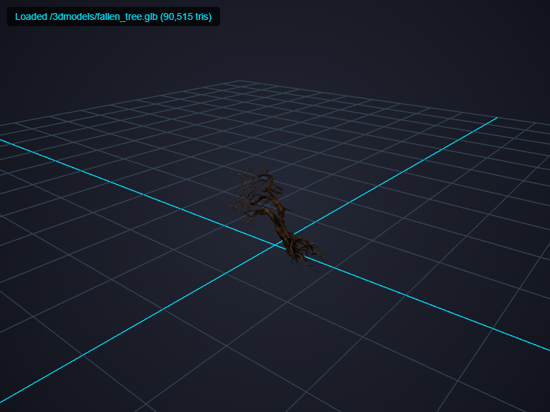

- **Identifier:** `fallen_tree`
- **Category:** Obstacle / Environment
- **File Size:** 16.40 MB (17,192,496 bytes)
- **Geometry:** 4 mesh(es), 90,515 triangles, 58,275 vertices
- **Bounding Box:** Width `6.29m`, Height `4.2m`, Depth `4.39m` (Center: `[-1.74, 1.47, -0.69]`)
- **Recommended Scale Factor:** `0.5 - 0.8`
- **Materials (4):** `MeshStandardMaterial` (diffuse/color, normal, roughness, metalness), `MeshStandardMaterial` (diffuse/color, normal, roughness, metalness, ao), `MeshStandardMaterial` (diffuse/color, normal, roughness, metalness, ao), `MeshStandardMaterial` (diffuse/color, normal, roughness, metalness, ao)
- **Animations:** None (Static Mesh)
- **Armature / Bones:** None
- **Suitability Rating:** **Heavy (Needs Optimization)**
- **Recommended Usage:** Large fallen tree trunk obstacle. High poly (90k tris) - requires decimation to <5k tris before deployment.
- **Integration Status:** `Needs Decimation`

---

### 6. `fern.glb` 

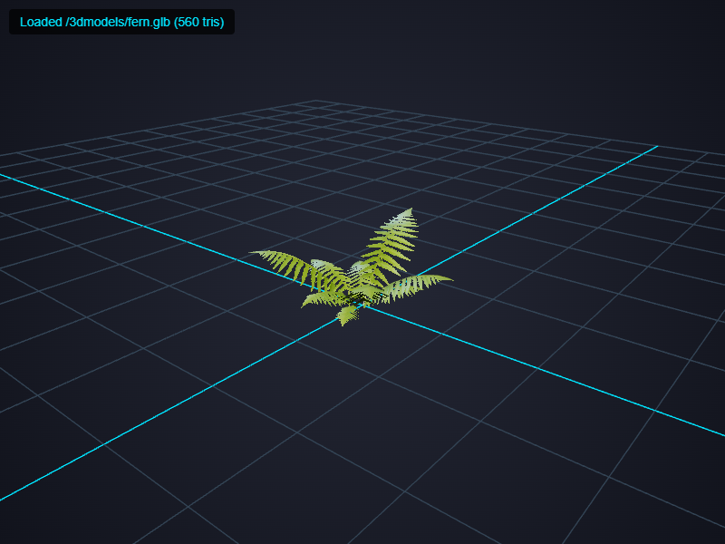

- **Identifier:** `fern`
- **Category:** Environment / Foliage
- **File Size:** 1.25 MB (1,314,476 bytes)
- **Geometry:** 1 mesh(es), 560 triangles, 480 vertices
- **Bounding Box:** Width `2.17m`, Height `0.93m`, Depth `2.26m` (Center: `[0.01, 0.46, -0.06]`)
- **Recommended Scale Factor:** `1.0`
- **Materials (1):** `MeshStandardMaterial` (diffuse/color, normal, roughness, metalness)
- **Animations:** None (Static Mesh)
- **Armature / Bones:** None
- **Suitability Rating:** **Optimal / Highly Suitable**
- **Recommended Usage:** Accent vegetation and flowers along the track boundary.
- **Integration Status:** `Ready for Environment Integration`

---

### 7. `flat_rocks.glb` 

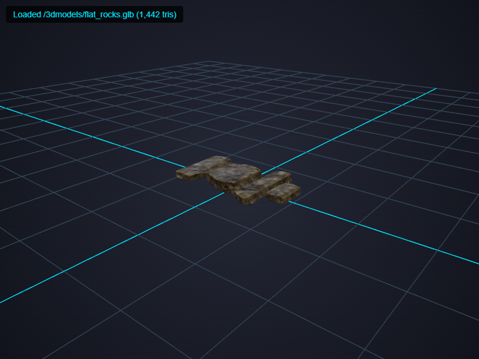

- **Identifier:** `flat_rocks`
- **Category:** Environment / Rocks
- **File Size:** 3.71 MB (3,888,488 bytes)
- **Geometry:** 4 mesh(es), 1,442 triangles, 1,044 vertices
- **Bounding Box:** Width `17.91m`, Height `1.88m`, Depth `10.83m` (Center: `[-0.29, 0.01, 0.08]`)
- **Recommended Scale Factor:** `0.3 - 0.5`
- **Materials (1):** `MeshPhysicalMaterial` (diffuse/color, normal, roughness, metalness)
- **Animations:** None (Static Mesh)
- **Armature / Bones:** None
- **Suitability Rating:** **Optimal / Highly Suitable**
- **Recommended Usage:** Trackside ground rock scatter and shoulder borders.
- **Integration Status:** `Ready for Environment Integration`

---

### 8. `flowering_plant.glb` 

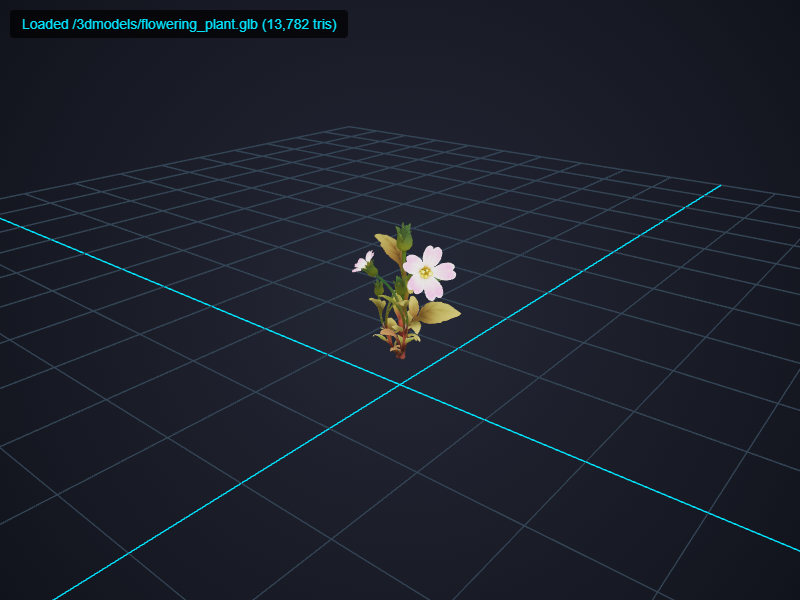

- **Identifier:** `flowering_plant`
- **Category:** Environment / Foliage
- **File Size:** 1.21 MB (1,268,180 bytes)
- **Geometry:** 3 mesh(es), 13,782 triangles, 10,728 vertices
- **Bounding Box:** Width `0.9m`, Height `1.08m`, Depth `0.68m` (Center: `[0.07, 0.45, 0.1]`)
- **Recommended Scale Factor:** `1.0`
- **Materials (1):** `MeshBasicMaterial` (diffuse/color)
- **Animations:** None (Static Mesh)
- **Armature / Bones:** None
- **Suitability Rating:** **Optimal / Highly Suitable**
- **Recommended Usage:** Accent vegetation and flowers along the track boundary.
- **Integration Status:** `Ready for Environment Integration`

---

### 9. `grass.glb` 

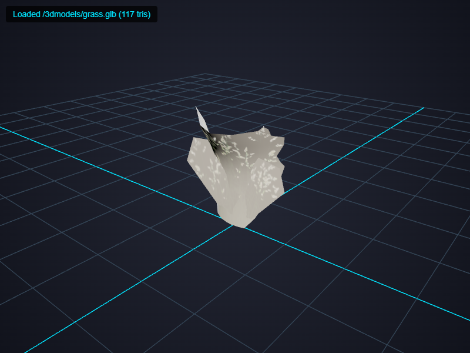

- **Identifier:** `grass`
- **Category:** Environment / Ground Foliage
- **File Size:** 1.61 MB (1,685,832 bytes)
- **Geometry:** 1 mesh(es), 117 triangles, 81 vertices
- **Bounding Box:** Width `1.1m`, Height `1.04m`, Depth `0.59m` (Center: `[0.01, 0.41, -0.05]`)
- **Recommended Scale Factor:** `1.0`
- **Materials (1):** `MeshStandardMaterial` (emissive, ao)
- **Animations:** None (Static Mesh)
- **Armature / Bones:** None
- **Suitability Rating:** **Optimal / Highly Suitable**
- **Recommended Usage:** Instanced ground grass tufts along road edges.
- **Integration Status:** `Ready for Environment Integration`

---

### 10. `grass_patch.glb` 

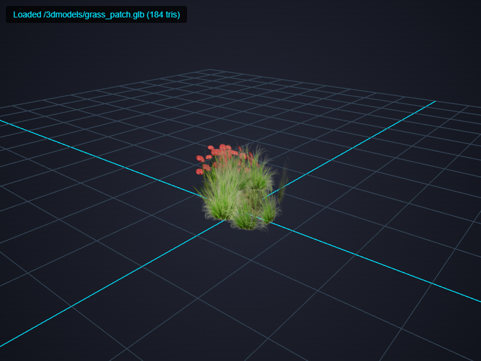

- **Identifier:** `grass_patch`
- **Category:** Environment / Ground Foliage
- **File Size:** 1002 KB (1,026,104 bytes)
- **Geometry:** 3 mesh(es), 184 triangles, 207 vertices
- **Bounding Box:** Width `5.78m`, Height `3.43m`, Depth `4.54m` (Center: `[0.12, 1.47, -0.41]`)
- **Recommended Scale Factor:** `1.0`
- **Materials (3):** `MeshStandardMaterial` (diffuse/color), `MeshStandardMaterial` (diffuse/color), `MeshStandardMaterial` (diffuse/color)
- **Animations:** None (Static Mesh)
- **Armature / Bones:** None
- **Suitability Rating:** **Optimal / Highly Suitable**
- **Recommended Usage:** Instanced ground grass tufts along road edges.
- **Integration Status:** `Ready for Environment Integration`

---

### 11. `grass_patches.glb` 

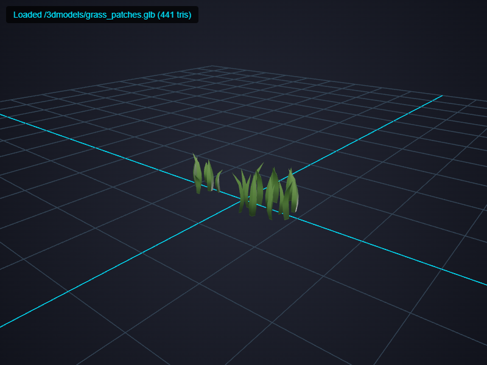

- **Identifier:** `grass_patches`
- **Category:** Environment / Ground Foliage
- **File Size:** 28 KB (28,888 bytes)
- **Geometry:** 2 mesh(es), 441 triangles, 567 vertices
- **Bounding Box:** Width `1.62m`, Height `0.51m`, Depth `0.73m` (Center: `[-0.37, 0.25, -0.03]`)
- **Recommended Scale Factor:** `1.0`
- **Materials (1):** `MeshStandardMaterial` (diffuse/color)
- **Animations:** None (Static Mesh)
- **Armature / Bones:** None
- **Suitability Rating:** **Optimal / Highly Suitable**
- **Recommended Usage:** Instanced ground grass tufts along road edges.
- **Integration Status:** `Ready for Environment Integration`

---

### 12. `large_stone.glb` 

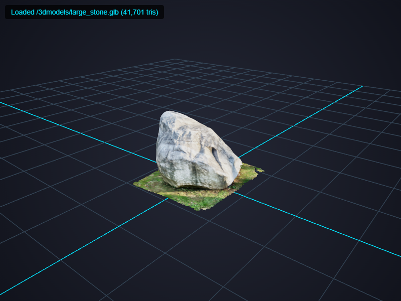

- **Identifier:** `large_stone`
- **Category:** Obstacle / Environment
- **File Size:** 2.40 MB (2,514,784 bytes)
- **Geometry:** 5 mesh(es), 41,701 triangles, 23,977 vertices
- **Bounding Box:** Width `1.83m`, Height `1.4m`, Depth `2.1m` (Center: `[-13.51, -0.63, 1.21]`)
- **Recommended Scale Factor:** `1.0`
- **Materials (5):** `MeshBasicMaterial` (diffuse/color), `MeshBasicMaterial` (diffuse/color), `MeshBasicMaterial` (diffuse/color), `MeshBasicMaterial` (diffuse/color), `MeshBasicMaterial` (diffuse/color)
- **Animations:** None (Static Mesh)
- **Armature / Bones:** None
- **Suitability Rating:** **Moderate / Acceptable**
- **Recommended Usage:** Large solid boulder obstacle blocking a single lane.
- **Integration Status:** `Ready for Integration`

---

### 13. `low_poly_mountain (1).glb` 

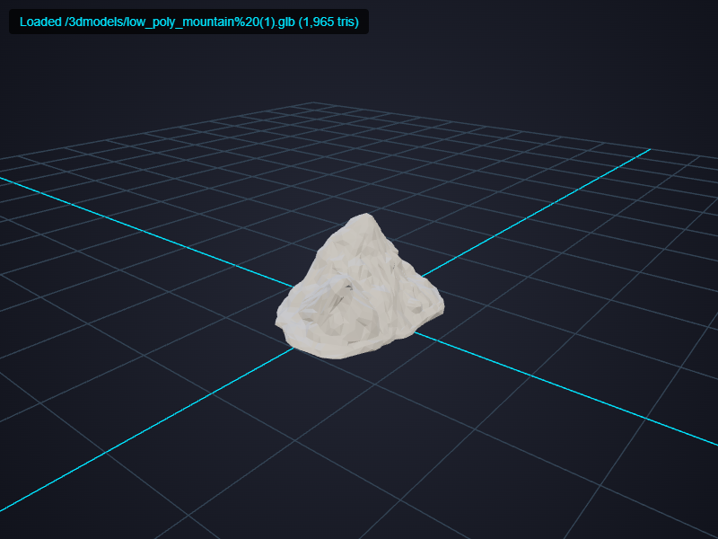

- **Identifier:** `low_poly_mountain_1`
- **Category:** Environment / Background Mountains
- **File Size:** 233 KB (238,720 bytes)
- **Geometry:** 1 mesh(es), 1,965 triangles, 5,616 vertices
- **Bounding Box:** Width `139.09m`, Height `98.91m`, Depth `180.94m` (Center: `[-411.4, 155.22, -419.9]`)
- **Recommended Scale Factor:** `1.0 - 2.0`
- **Materials (1):** `MeshStandardMaterial` (no textures)
- **Animations:** None (Static Mesh)
- **Armature / Bones:** None
- **Suitability Rating:** **Optimal / Highly Suitable**
- **Recommended Usage:** Distant background skyline parallax mountains. Ultra-lightweight and visually striking.
- **Integration Status:** `Ready for Environment Integration`

---

### 14. `low_poly_mountain (2).glb` 

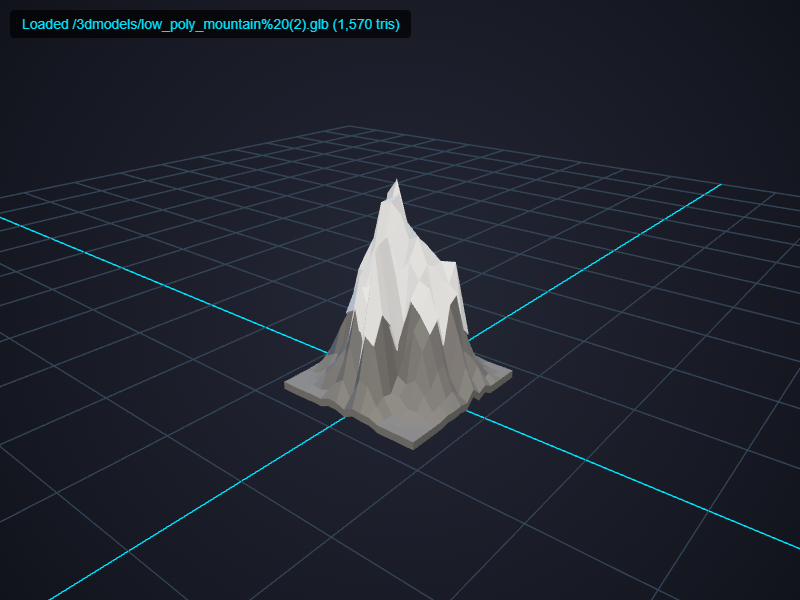

- **Identifier:** `low_poly_mountain_2`
- **Category:** Environment / Background Mountains
- **File Size:** 116 KB (119,264 bytes)
- **Geometry:** 2 mesh(es), 1,570 triangles, 3,030 vertices
- **Bounding Box:** Width `203.2m`, Height `253.23m`, Depth `203.2m` (Center: `[-0.38, 118.5, -3.82]`)
- **Recommended Scale Factor:** `1.0 - 2.0`
- **Materials (2):** `MeshStandardMaterial` (no textures), `MeshStandardMaterial` (no textures)
- **Animations:** None (Static Mesh)
- **Armature / Bones:** None
- **Suitability Rating:** **Optimal / Highly Suitable**
- **Recommended Usage:** Distant background skyline parallax mountains. Ultra-lightweight and visually striking.
- **Integration Status:** `Ready for Environment Integration`

---

### 15. `low_poly_mountain.glb` 

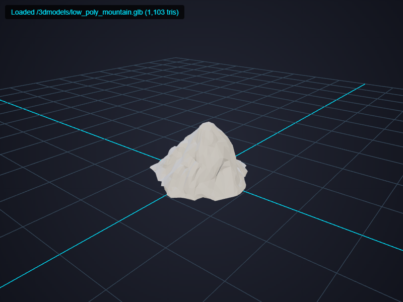

- **Identifier:** `low_poly_mountain`
- **Category:** Environment / Background Mountains
- **File Size:** 145 KB (148,076 bytes)
- **Geometry:** 1 mesh(es), 1,103 triangles, 3,107 vertices
- **Bounding Box:** Width `115.99m`, Height `65.54m`, Depth `115.9m` (Center: `[-259.39, 138.34, -290]`)
- **Recommended Scale Factor:** `1.0 - 2.0`
- **Materials (1):** `MeshStandardMaterial` (no textures)
- **Animations:** None (Static Mesh)
- **Armature / Bones:** None
- **Suitability Rating:** **Optimal / Highly Suitable**
- **Recommended Usage:** Distant background skyline parallax mountains. Ultra-lightweight and visually striking.
- **Integration Status:** `Ready for Environment Integration`

---

### 16. `low_poly_mountain_free.glb` 

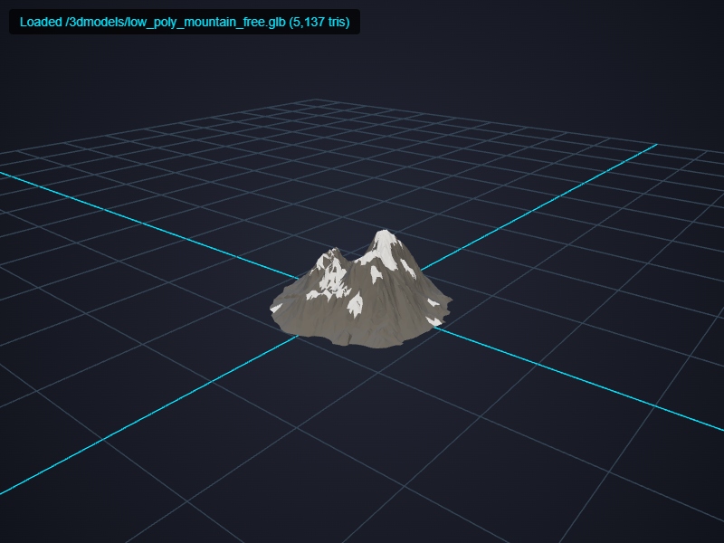

- **Identifier:** `low_poly_mountain_free`
- **Category:** Environment / Background Mountains
- **File Size:** 545 KB (558,244 bytes)
- **Geometry:** 2 mesh(es), 5,137 triangles, 15,411 vertices
- **Bounding Box:** Width `5.73m`, Height `2.29m`, Depth `6.03m` (Center: `[1.29, 1.14, -1.2]`)
- **Recommended Scale Factor:** `20.0 - 50.0`
- **Materials (2):** `MeshStandardMaterial` (no textures), `MeshStandardMaterial` (no textures)
- **Animations:** None (Static Mesh)
- **Armature / Bones:** None
- **Suitability Rating:** **Optimal / Highly Suitable**
- **Recommended Usage:** Distant background skyline parallax mountains. Ultra-lightweight and visually striking.
- **Integration Status:** `Ready for Environment Integration`

---

### 17. `mossy_old_tree_log.glb` 

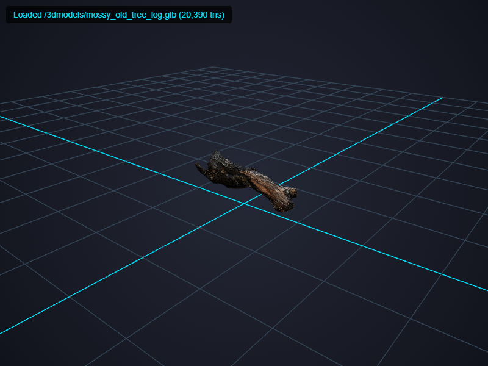

- **Identifier:** `mossy_old_tree_log`
- **Category:** Obstacle / Environment
- **File Size:** 3.41 MB (3,577,104 bytes)
- **Geometry:** 1 mesh(es), 20,390 triangles, 12,835 vertices
- **Bounding Box:** Width `1.53m`, Height `0.58m`, Depth `1.22m` (Center: `[0.23, 0.24, 1.92]`)
- **Recommended Scale Factor:** `1.5 - 2.0`
- **Materials (1):** `MeshStandardMaterial` (diffuse/color, normal, roughness, metalness)
- **Animations:** None (Static Mesh)
- **Armature / Bones:** None
- **Suitability Rating:** **Optimal / Highly Suitable**
- **Recommended Usage:** Lane-blocking hurdle obstacle. Goku must jump over or switch lanes.
- **Integration Status:** `Ready for Obstacle Integration`

---

### 18. `oak_tree.glb` 

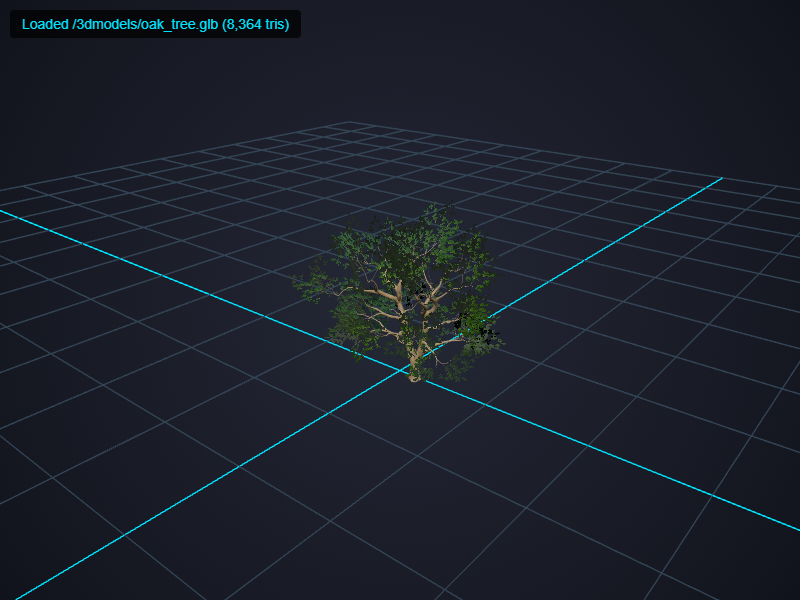

- **Identifier:** `oak_tree`
- **Category:** Environment / Foliage (Trees)
- **File Size:** 6.99 MB (7,327,152 bytes)
- **Geometry:** 2 mesh(es), 8,364 triangles, 6,526 vertices
- **Bounding Box:** Width `10.53m`, Height `8.83m`, Depth `8.2m` (Center: `[-1.12, 4.41, -0.2]`)
- **Recommended Scale Factor:** `0.8 - 1.2`
- **Materials (2):** `MeshStandardMaterial` (diffuse/color, normal, roughness, metalness), `MeshStandardMaterial` (diffuse/color, normal, roughness, metalness)
- **Animations:** None (Static Mesh)
- **Armature / Bones:** None
- **Suitability Rating:** **Optimal / Highly Suitable**
- **Recommended Usage:** Deciduous roadside canopy tree.
- **Integration Status:** `Ready for Environment Integration`

---

### 19. `pine_tree (1).glb` 

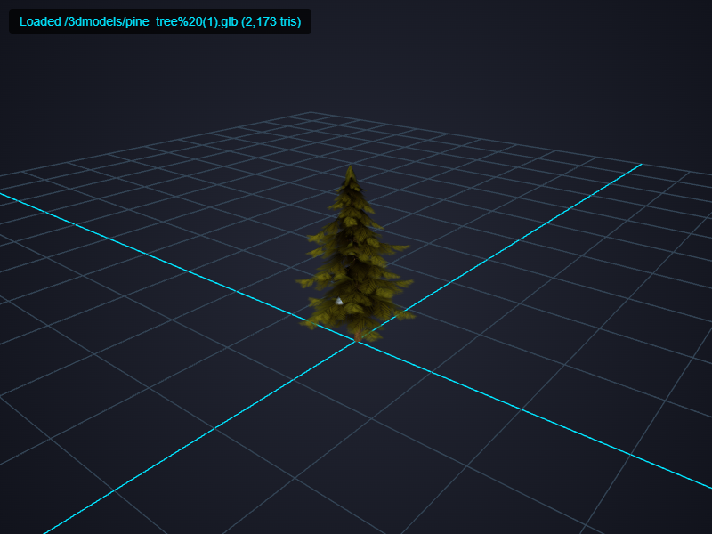

- **Identifier:** `pine_tree_1`
- **Category:** Environment / Foliage (Trees)
- **File Size:** 1.55 MB (1,624,028 bytes)
- **Geometry:** 2 mesh(es), 2,173 triangles, 5,020 vertices
- **Bounding Box:** Width `217.06m`, Height `307.78m`, Depth `217.12m` (Center: `[-0.84, 153.89, 3.93]`)
- **Recommended Scale Factor:** `0.03 (native units ~300)`
- **Materials (2):** `MeshStandardMaterial` (diffuse/color), `MeshStandardMaterial` (diffuse/color, normal)
- **Animations:** None (Static Mesh)
- **Armature / Bones:** None
- **Suitability Rating:** **Optimal / Highly Suitable**
- **Recommended Usage:** Conifer pine tree for forest and mountain biomes. Low poly (2.1k tris). Preferred over 437k tris version.
- **Integration Status:** `Ready for Environment Integration (Preferred Pine)`

---

### 20. `pine_tree.glb` 

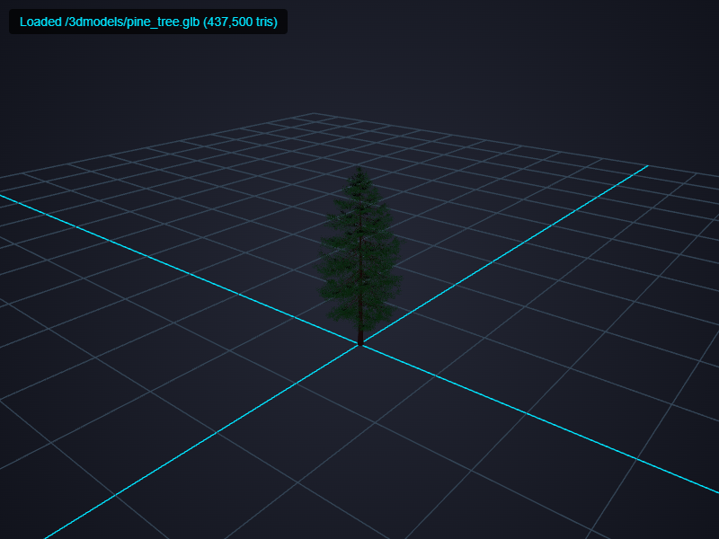

- **Identifier:** `pine_tree`
- **Category:** Heavy / Unsuitable
- **File Size:** 25.93 MB (27,193,468 bytes)
- **Geometry:** 12 mesh(es), 437,500 triangles, 685,361 vertices
- **Bounding Box:** Width `23.07m`, Height `47.69m`, Depth `25.03m` (Center: `[-0.25, 23.84, 0.19]`)
- **Recommended Scale Factor:** `N/A`
- **Materials (2):** `MeshStandardMaterial` (no textures), `MeshStandardMaterial` (no textures)
- **Animations:** None (Static Mesh)
- **Armature / Bones:** None
- **Suitability Rating:** **Heavy / Unsuitable without Decimation**
- **Recommended Usage:** Excessive polygon count (>120k - 500k tris) or file size (>20MB - 40MB). Excluded from mobile runner.
- **Integration Status:** `Rejected / Superseded by Low-Poly Alternatives`

---

### 21. `realistics_grass_07.glb` 

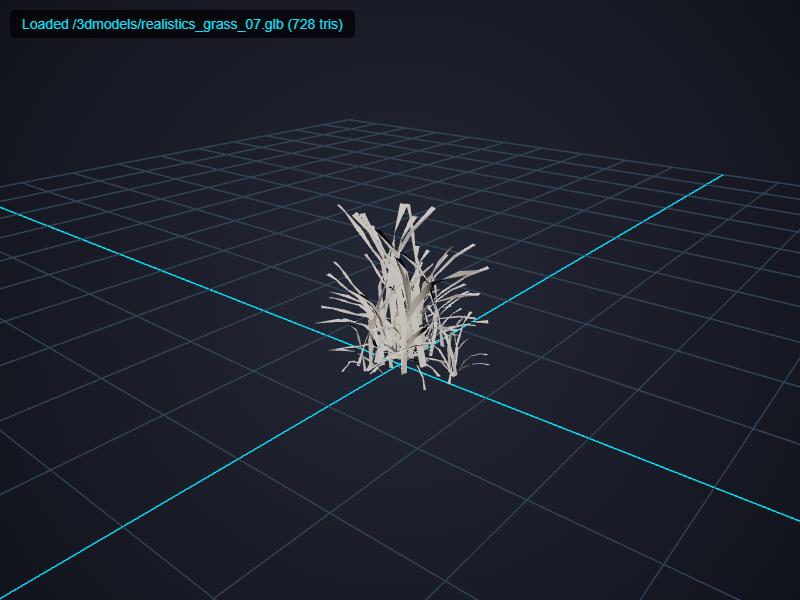

- **Identifier:** `realistics_grass_07`
- **Category:** Environment / Ground Foliage
- **File Size:** 255 KB (260,992 bytes)
- **Geometry:** 1 mesh(es), 728 triangles, 1,490 vertices
- **Bounding Box:** Width `45.48m`, Height `34.78m`, Depth `45.72m` (Center: `[-0.02, 15.25, -1.14]`)
- **Recommended Scale Factor:** `1.0`
- **Materials (1):** `MeshStandardMaterial` (no textures)
- **Animations:** None (Static Mesh)
- **Armature / Bones:** None
- **Suitability Rating:** **Optimal / Highly Suitable**
- **Recommended Usage:** Instanced ground grass tufts along road edges.
- **Integration Status:** `Ready for Environment Integration`

---

### 22. `realistic_trees_collection.glb` 

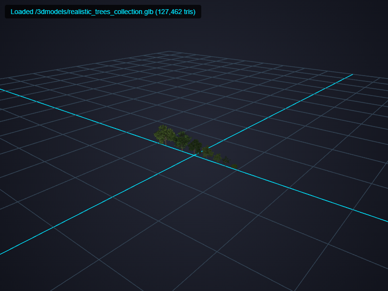

- **Identifier:** `realistic_trees_collection`
- **Category:** Heavy / Unsuitable
- **File Size:** 40.37 MB (42,333,844 bytes)
- **Geometry:** 15 mesh(es), 127,462 triangles, 261,435 vertices
- **Bounding Box:** Width `472.68m`, Height `110.36m`, Depth `112.44m` (Center: `[-8.72, 53.68, 2.39]`)
- **Recommended Scale Factor:** `N/A`
- **Materials (14):** `MeshStandardMaterial` (diffuse/color, normal), `MeshStandardMaterial` (diffuse/color), `MeshStandardMaterial` (diffuse/color, normal), `MeshStandardMaterial` (diffuse/color), `MeshStandardMaterial` (diffuse/color, normal), `MeshStandardMaterial` (diffuse/color), `MeshStandardMaterial` (diffuse/color), `MeshStandardMaterial` (diffuse/color, normal), `MeshStandardMaterial` (diffuse/color), `MeshStandardMaterial` (diffuse/color, normal), `MeshStandardMaterial` (diffuse/color), `MeshStandardMaterial` (diffuse/color, normal), `MeshStandardMaterial` (diffuse/color), `MeshStandardMaterial` (diffuse/color, normal)
- **Animations:** None (Static Mesh)
- **Armature / Bones:** None
- **Suitability Rating:** **Heavy / Unsuitable without Decimation**
- **Recommended Usage:** Excessive polygon count (>120k - 500k tris) or file size (>20MB - 40MB). Excluded from mobile runner.
- **Integration Status:** `Rejected / Superseded by Low-Poly Alternatives`

---

### 23. `rocks_and_trees.glb` 

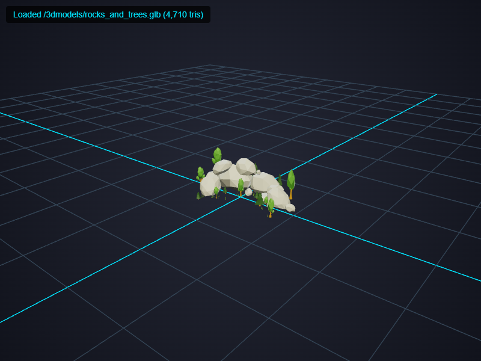

- **Identifier:** `rocks_and_trees`
- **Category:** Environment / Prop Cluster
- **File Size:** 495 KB (506,796 bytes)
- **Geometry:** 43 mesh(es), 4,710 triangles, 11,982 vertices
- **Bounding Box:** Width `1.64m`, Height `0.49m`, Depth `0.95m` (Center: `[0, 0.04, 0]`)
- **Recommended Scale Factor:** `2.0 - 3.0`
- **Materials (5):** `MeshStandardMaterial` (diffuse/color), `MeshStandardMaterial` (no textures), `MeshStandardMaterial` (diffuse/color), `MeshStandardMaterial` (no textures), `MeshStandardMaterial` (diffuse/color)
- **Animations:** None (Static Mesh)
- **Armature / Bones:** None
- **Suitability Rating:** **Optimal / Highly Suitable**
- **Recommended Usage:** Pre-assembled prop vignette (rocks + miniature trees) for trackside scenery.
- **Integration Status:** `Ready for Environment Integration`

---

### 24. `smallrocks1.glb` 

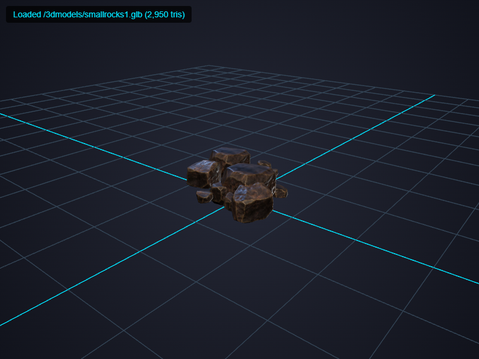

- **Identifier:** `smallrocks1`
- **Category:** Environment / Rocks
- **File Size:** 3.02 MB (3,170,452 bytes)
- **Geometry:** 6 mesh(es), 2,950 triangles, 2,037 vertices
- **Bounding Box:** Width `4.05m`, Height `1.48m`, Depth `3.78m` (Center: `[-0.81, 0.18, -0.66]`)
- **Recommended Scale Factor:** `1.0`
- **Materials (1):** `MeshStandardMaterial` (diffuse/color, normal, roughness, metalness)
- **Animations:** None (Static Mesh)
- **Armature / Bones:** None
- **Suitability Rating:** **Optimal / Highly Suitable**
- **Recommended Usage:** Trackside ground rock scatter and shoulder borders.
- **Integration Status:** `Ready for Environment Integration`

---

### 25. `small_folliage_plant.glb` 

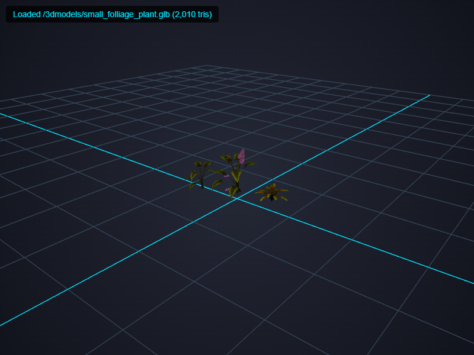

- **Identifier:** `small_folliage_plant`
- **Category:** Environment / Foliage
- **File Size:** 1.19 MB (1,248,912 bytes)
- **Geometry:** 1 mesh(es), 2,010 triangles, 3,644 vertices
- **Bounding Box:** Width `9.16m`, Height `3.76m`, Depth `3.94m` (Center: `[0.46, 1, -0.28]`)
- **Recommended Scale Factor:** `1.0`
- **Materials (1):** `MeshPhysicalMaterial` (diffuse/color, normal, roughness, metalness)
- **Animations:** None (Static Mesh)
- **Armature / Bones:** None
- **Suitability Rating:** **Optimal / Highly Suitable**
- **Recommended Usage:** Accent vegetation and flowers along the track boundary.
- **Integration Status:** `Ready for Environment Integration`

---

### 26. `small_rocks.glb` 

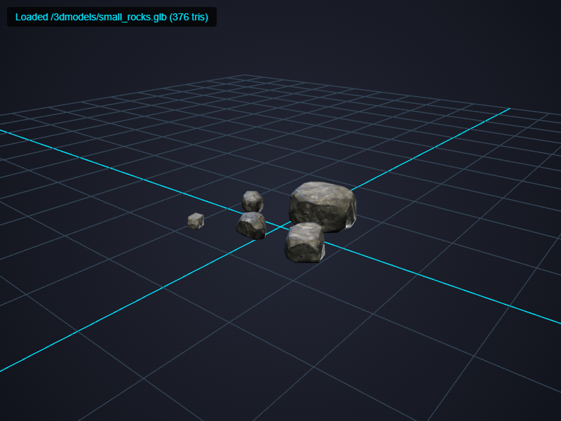

- **Identifier:** `small_rocks`
- **Category:** Environment / Rocks
- **File Size:** 3.93 MB (4,116,544 bytes)
- **Geometry:** 5 mesh(es), 376 triangles, 315 vertices
- **Bounding Box:** Width `2.24m`, Height `0.57m`, Depth `1.93m` (Center: `[-0.11, 0.3, -0.93]`)
- **Recommended Scale Factor:** `1.0`
- **Materials (1):** `MeshStandardMaterial` (diffuse/color, normal, roughness, metalness)
- **Animations:** None (Static Mesh)
- **Armature / Bones:** None
- **Suitability Rating:** **Optimal / Highly Suitable**
- **Recommended Usage:** Trackside ground rock scatter and shoulder borders.
- **Integration Status:** `Ready for Environment Integration`

---

### 27. `small_trees.glb` 

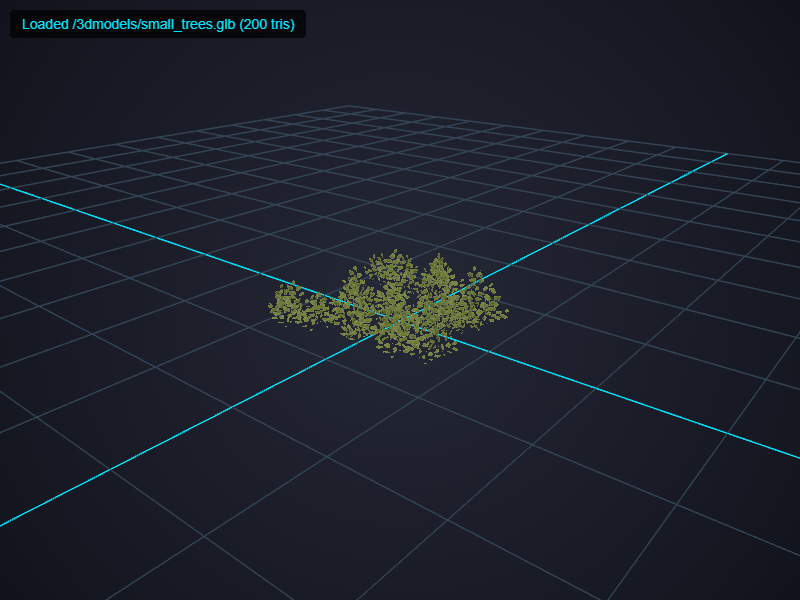

- **Identifier:** `small_trees`
- **Category:** Environment / Foliage (Trees)
- **File Size:** 120 KB (122,988 bytes)
- **Geometry:** 2 mesh(es), 200 triangles, 400 vertices
- **Bounding Box:** Width `4.91m`, Height `1.17m`, Depth `4.82m` (Center: `[0.09, 0.59, -0.07]`)
- **Recommended Scale Factor:** `1.0 - 1.5`
- **Materials (1):** `MeshStandardMaterial` (diffuse/color)
- **Animations:** None (Static Mesh)
- **Armature / Bones:** None
- **Suitability Rating:** **Optimal / Highly Suitable**
- **Recommended Usage:** Ultra-low-poly roadside trees (200 tris). Perfect for high-density instancing.
- **Integration Status:** `Ready for Environment Integration`

---

### 28. `stalagmitecrystalore_cluster_-_meshy.glb` 

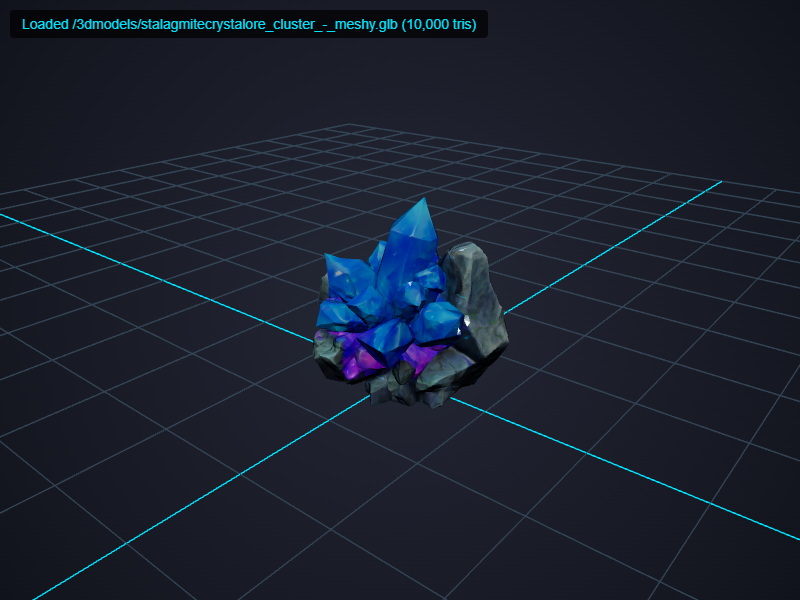

- **Identifier:** `stalagmitecrystalore_cluster`
- **Category:** Collectible / Special Prop
- **File Size:** 2.52 MB (2,638,356 bytes)
- **Geometry:** 1 mesh(es), 10,000 triangles, 30,000 vertices
- **Bounding Box:** Width `2m`, Height `1.82m`, Depth `1.56m` (Center: `[0, 0, 0]`)
- **Recommended Scale Factor:** `1.0`
- **Materials (1):** `MeshPhysicalMaterial` (diffuse/color)
- **Animations:** None (Static Mesh)
- **Armature / Bones:** None
- **Suitability Rating:** **Optimal / Highly Suitable**
- **Recommended Usage:** Ki Crystal / Powerup node or glowing hazard crystal. Adds rich visual energy to the track.
- **Integration Status:** `Ready for Integration`

---

### 29. `stylized_bush.glb` 

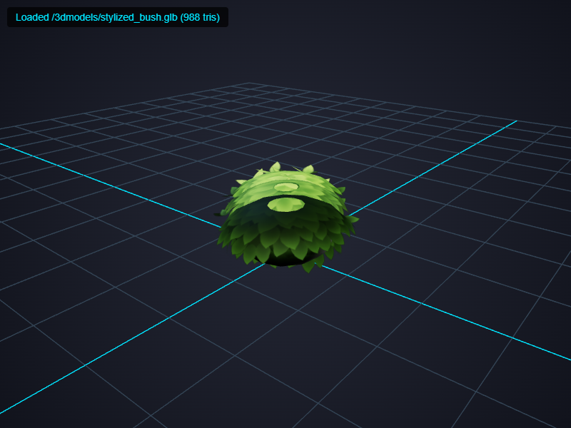

- **Identifier:** `stylized_bush`
- **Category:** Environment / Foliage
- **File Size:** 572 KB (585,288 bytes)
- **Geometry:** 1 mesh(es), 988 triangles, 629 vertices
- **Bounding Box:** Width `1.51m`, Height `0.96m`, Depth `1.58m` (Center: `[-0.03, 0.45, -0.03]`)
- **Recommended Scale Factor:** `1.2 - 1.8`
- **Materials (1):** `MeshPhysicalMaterial` (diffuse/color)
- **Animations:** None (Static Mesh)
- **Armature / Bones:** None
- **Suitability Rating:** **Optimal / Highly Suitable**
- **Recommended Usage:** Roadside bushes and track hedges. Matches anime cell-shaded look cleanly.
- **Integration Status:** `Ready for Environment Integration (Preferred Bush)`

---

### 30. `tree_broken_mossy_branch_pbr_photogrammetry_free.glb` 

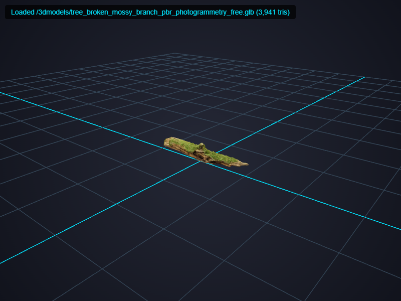

- **Identifier:** `tree_broken_mossy_branch`
- **Category:** Obstacle / Environment
- **File Size:** 5.55 MB (5,824,016 bytes)
- **Geometry:** 1 mesh(es), 3,941 triangles, 11,823 vertices
- **Bounding Box:** Width `0.62m`, Height `0.13m`, Depth `0.12m` (Center: `[0.01, 0.07, 0]`)
- **Recommended Scale Factor:** `3.0 - 5.0`
- **Materials (1):** `MeshPhysicalMaterial` (diffuse/color, normal, roughness, metalness, emissive, ao)
- **Animations:** None (Static Mesh)
- **Armature / Bones:** None
- **Suitability Rating:** **Optimal / Highly Suitable**
- **Recommended Usage:** Trackside log / branch obstacle or prop.
- **Integration Status:** `Ready for Integration`

---

### 31. `wooden_bridge.glb` 

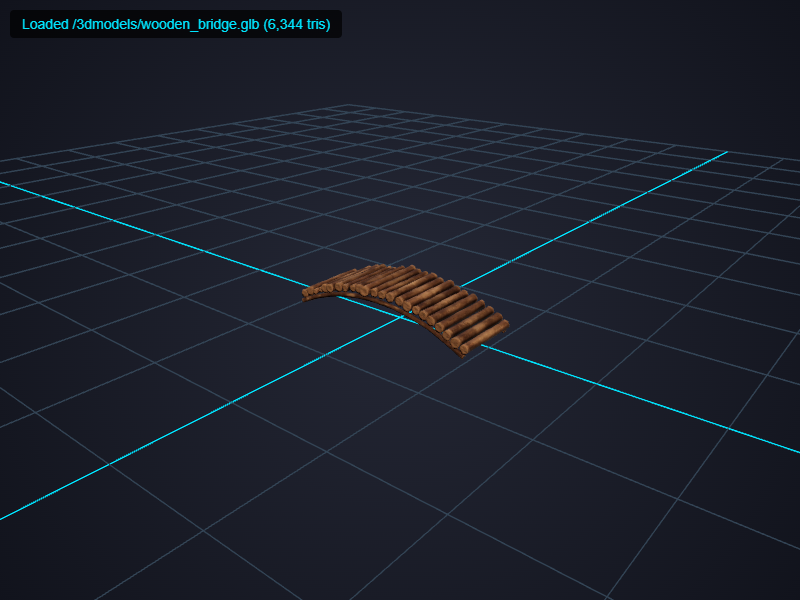

- **Identifier:** `wooden_bridge`
- **Category:** Obstacle / Pathway
- **File Size:** 2.85 MB (2,987,536 bytes)
- **Geometry:** 1 mesh(es), 6,344 triangles, 4,036 vertices
- **Bounding Box:** Width `420.02m`, Height `83.35m`, Depth `152.74m` (Center: `[-0.6, 24.58, 0]`)
- **Recommended Scale Factor:** `0.02 (native coordinates in cm: ~420 units wide)`
- **Materials (1):** `MeshStandardMaterial` (diffuse/color, normal, roughness, metalness, ao)
- **Animations:** None (Static Mesh)
- **Armature / Bones:** None
- **Suitability Rating:** **Optimal / Highly Suitable**
- **Recommended Usage:** Elevated ramp obstacle, archway, or bridge section spanning across lanes.
- **Integration Status:** `Ready for Obstacle Integration`

---

### 32. `extracted_gogeta/source/a931b105-49c4-43f6-9362-51f3478d2624.glb` 

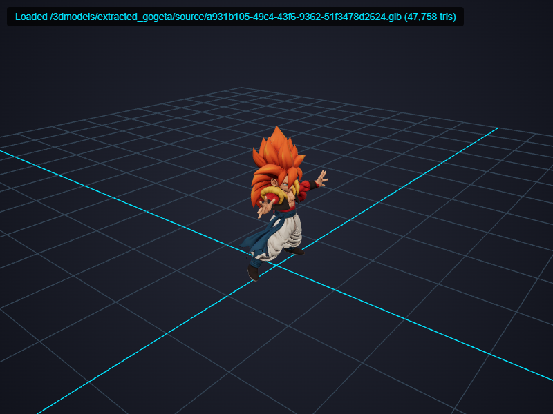

- **Identifier:** `gogeta_character`
- **Category:** Character
- **File Size:** 1.81 MB (1,895,840 bytes)
- **Geometry:** 1 mesh(es), 47,758 triangles, 28,735 vertices
- **Bounding Box:** Width `0.4m`, Height `1m`, Depth `0.78m` (Center: `[0, 0, 0]`)
- **Recommended Scale Factor:** `2.0 (currently 1m tall; scale to ~2.0m)`
- **Materials (1):** `MeshStandardMaterial` (diffuse/color)
- **Animations:** None (Static Mesh)
- **Armature / Bones:** None
- **Suitability Rating:** **Moderate / Acceptable**
- **Recommended Usage:** High-detail hero character model (Gogeta). Ideal as unlockable character skin or fusion transformation mode.
- **Integration Status:** `Ready for Character Integration (Phase 01)`

---

### 33. `extracted_stylized_mountain/source/montain.glb` 

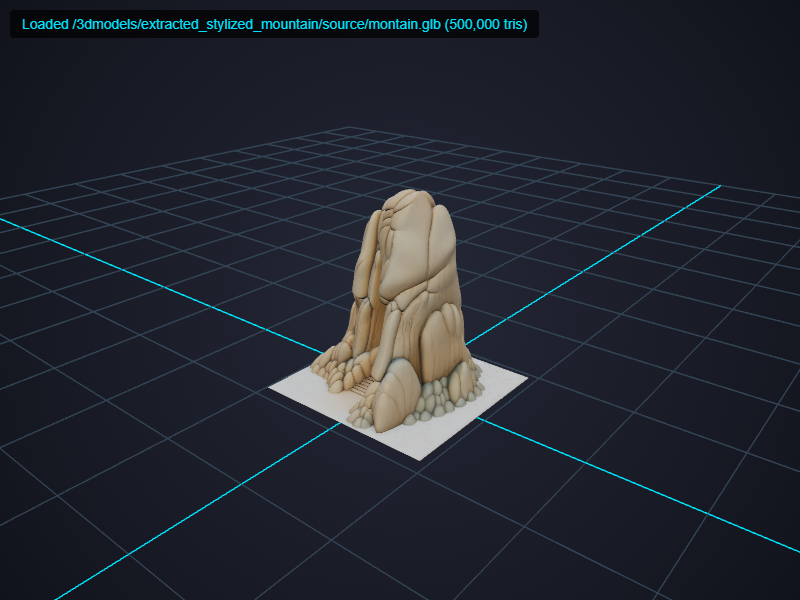

- **Identifier:** `stylized_mountain_extracted`
- **Category:** Heavy / Unsuitable
- **File Size:** 23.59 MB (24,736,584 bytes)
- **Geometry:** 1 mesh(es), 500,000 triangles, 293,904 vertices
- **Bounding Box:** Width `0.69m`, Height `0.73m`, Depth `0.65m` (Center: `[0, 0, 0]`)
- **Recommended Scale Factor:** `N/A`
- **Materials (1):** `MeshPhysicalMaterial` (diffuse/color, normal, roughness, metalness)
- **Animations:** None (Static Mesh)
- **Armature / Bones:** None
- **Suitability Rating:** **Heavy / Unsuitable without Decimation**
- **Recommended Usage:** Excessive polygon count (>120k - 500k tris) or file size (>20MB - 40MB). Excluded from mobile runner.
- **Integration Status:** `Rejected / Superseded by Low-Poly Alternatives`

---

