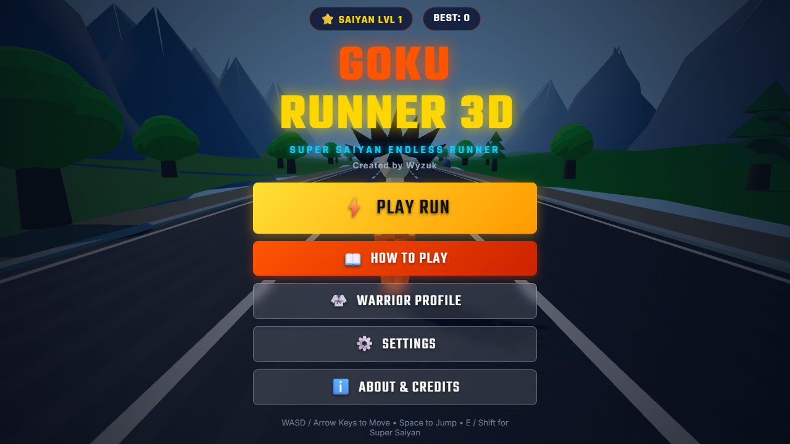
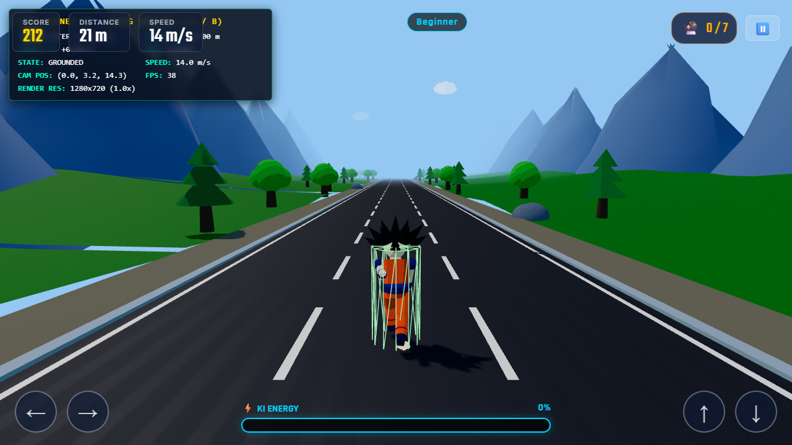
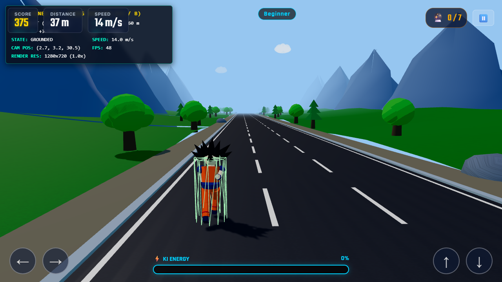
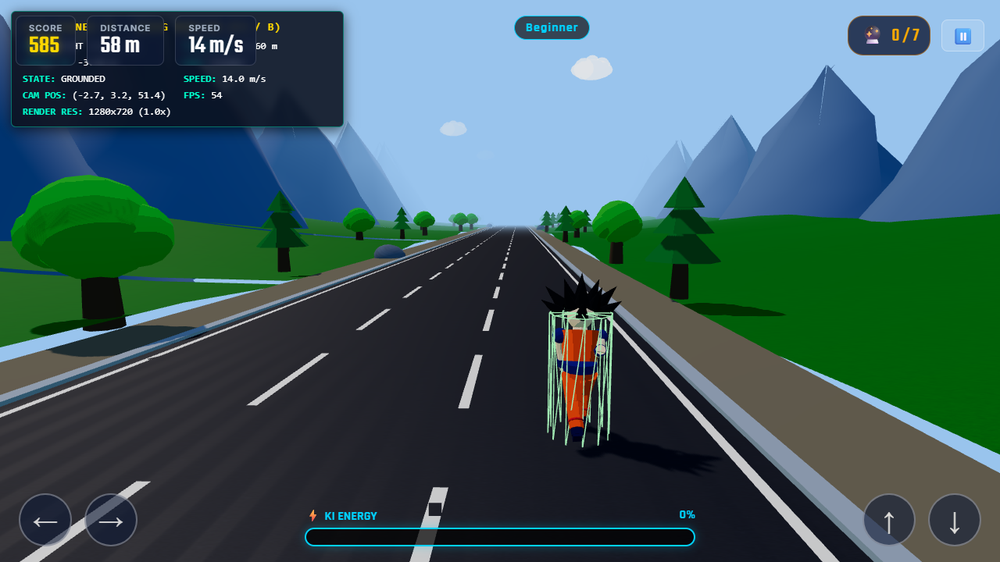
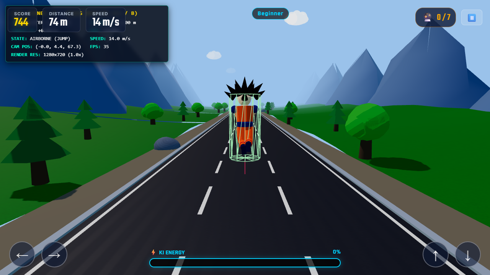
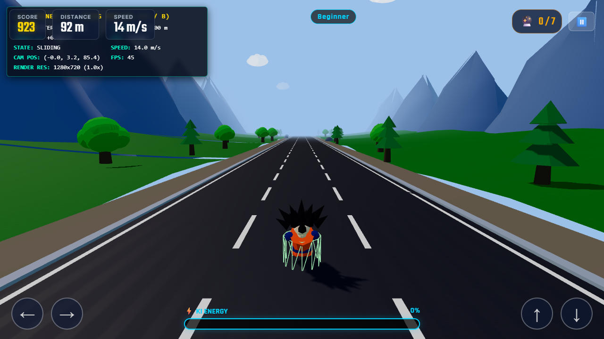
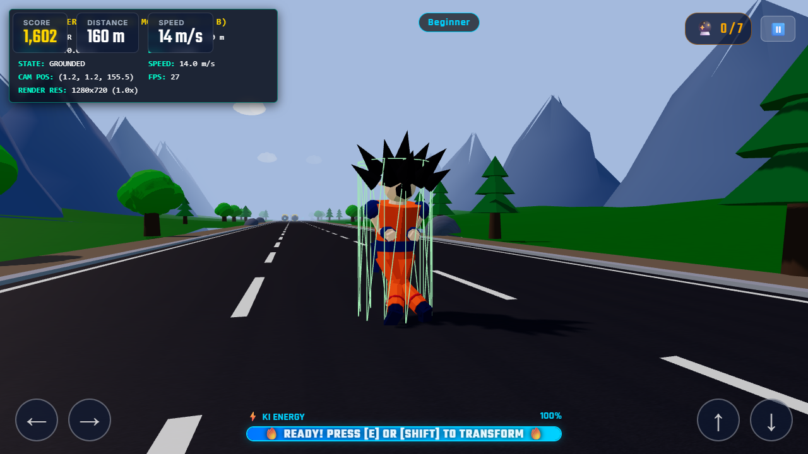
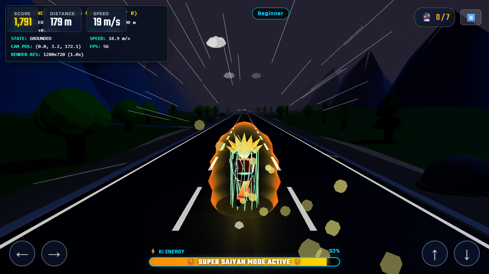
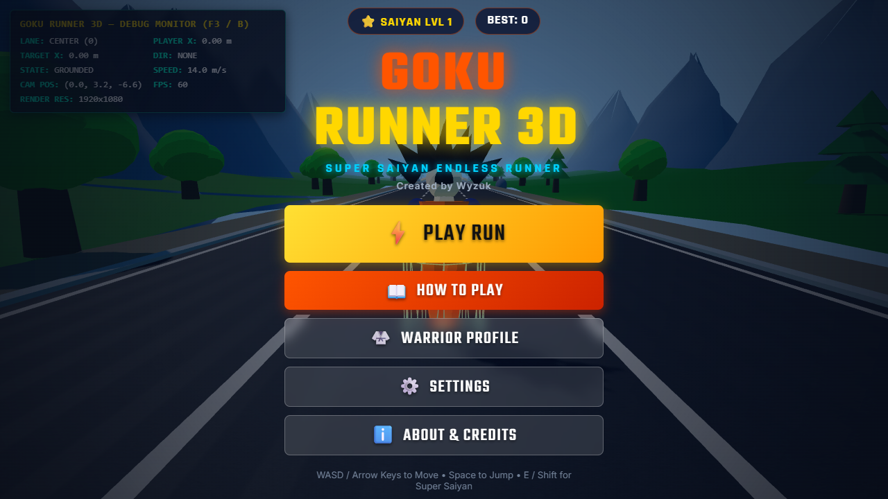
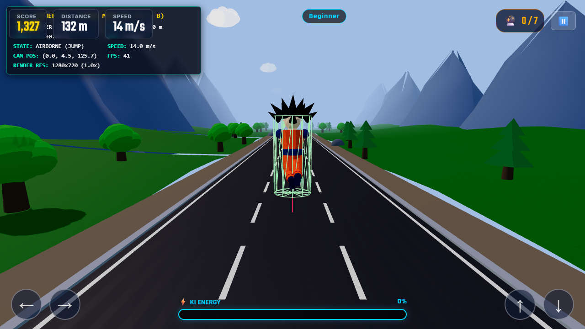

# ⚡ GOKU RUNNER 3D ⚡
### A High-Performance 3D Browser Endless Runner Built with Three.js

[](https://opensource.org/licenses/MIT)
[](https://threejs.org/)
[](https://vitejs.dev/)
[](https://github.com/wyzuk)

**Goku Runner 3D** is a complete, feature-rich, high-performance browser-based 3D endless runner inspired by Dragon Ball. Sprint across procedurally generated anime biomes, dodge hazards, leap over barriers, slide beneath overhead arches, gather legendary Dragon Balls and Ki energy, and unleash the mighty **Super Saiyan** transformation!

---

## 🎮 Gameplay Features

- **Custom 3D Goku Character**:
  - 100% original procedural anime-proportioned character geometry with signature spiky Saiyan hair sections, anime face, orange Gi with chest/back Kanji emblems, blue undershirt, wristbands, knotted belt with swaying sash tails, and blue boots.
  - Articulated hierarchical skeletal rig supporting run cycles, dynamic jump ascents, compression landings, slide postures, and Super Saiyan power-up postures.
- **Anime Cel Shading & Shaders**:
  - Stepped ramp toon materials and custom GLSL noise aura shaders.
- **Super Saiyan Transformation**:
  - Ki meter charges by collecting cyan energy orbs.
  - At 100% Ki, press `E` or `Shift` (or mobile touch button) to trigger a cinematic transformation sequence: dramatic camera slow-mo, golden spiky hair flare, turquoise eyes, pulsating golden aura energy shell, dancing electric lightning arcs, and high-speed invulnerability!
- **Procedural Chunk-Based Worlds**:
  - Seamless chunk streaming ahead of the runner and recycling behind the camera.
  - **6 Visually Distinct Biomes**:
    1. *Earth Valley* (Green rolling hills, lush oak and pine trees, blue skies)
    2. *Rocky Mountain Pass* (Tall craggy peaks, narrow corridors, boulders)
    3. *Forest Kingdom* (Dense woodlands, tall pines, sun shafts)
    4. *Desert Wasteland* (Rolling sand dunes, cacti, canyons)
    5. *Floating Sky Islands* (Airborne landmasses, magical waterfalls)
    6. *Kami's Realm* (White marble pedestals, golden capitals, ethereal sky)
- **Dynamic Day & Night Cycle**:
  - Real-time smooth transitions between *Sunrise*, *Afternoon*, *Sunset*, *Evening*, and *Night* with starfields and dynamic sun/moon directional lighting.
- **Dynamic Weather System**:
  - *Clear*, *Cloudy*, *Light Rain*, *Thunderstorm* (with random lightning flashes), and atmospheric distance fog.
- **Fair Procedural Obstacle Patterns**:
  - Static rocks & pillars (lane change required)
  - Low logs & barriers (jump required)
  - Overhead arches & beams (slide required)
  - Moving rolling hazards (timed lane shifts)
  - Guaranteed survivable lane pathways at every difficulty tier.
- **Collectibles & Power-Ups**:
  - 7-Star Dragon Balls with internal star geometry and pickup sparkle bursts
  - Glowing Ki energy orbs with pulsing shells
  - 5 Unique Power-ups: *Flying Nimbus*, *Senzu Bean*, *Ki Surge*, *Magnetic Aura*, and *Zenkai Boost*.
- **Sound Engine (Zero External Audio Dependencies)**:
  - Procedural Web Audio API synthesizers for footsteps, aerodynamic whooshes, landing impacts, slide friction, crystalline Dragon Ball pickup chimes, Ki resonance hums, Super Saiyan transformation blasts, and multi-track arcade synth background music that accelerates tempo in Super Saiyan mode.
- **Progression, Leveling & Persistence**:
  - Persistent leveling curve based on formula `XPRequired(level) = Math.floor(500 * level^1.35)`.
  - Score multiplier and streak combo system (up to 3.0x multiplier).
  - Milestone celebrations (500m to 100,000m) with fanfare banners.
  - Daily Saiyan Training challenges with real-date persistence.
  - 14+ Achievements with XP rewards stored in versioned `localStorage`.
- **Cross-Platform Controls**:
  - Dual desktop keyboard schemes: **WASD** and **Arrow Keys** work simultaneously without needing to toggle settings.
  - Mobile swipe gestures + customizable on-screen touch D-Pad buttons.
- **Interactive First-Time Tutorial**:
  - 7-step interactive onboarding with live key detection, progress bar, skip options, and a +500 XP completion reward.

---

## 📸 Screenshots

| Main Menu (Bright Daylight) | Gameplay (Center Lane) |
|:---:|:---:|
|  |  |

| Left Lane Move (`A` / `←`) | Right Lane Move (`D` / `→`) |
|:---:|:---:|
|  |  |

| Airborne Jump (`W` / `↑`) | Low Slide (`S` / `↓`) |
|:---:|:---:|
|  |  |

| Super Saiyan Golden Aura | Moonlit Night Atmosphere |
|:---:|:---:|
|  |  |

| Development Debug Monitor (`F3` / `B`) | On-Screen Mobile Touch Controls |
|:---:|:---:|
|  |  |

---

## 🕹️ Controls

| Action | Primary Key | Alternative Key | Mobile Gesture / Button |
|---|---|---|---|
| **Move Left** | `A` | `Left Arrow` | Swipe Left / `←` Button |
| **Move Right** | `D` | `Right Arrow` | Swipe Right / `→` Button |
| **Jump** | `W` | `Up Arrow` / `Space` | Swipe Up / `↑` Button |
| **Slide** | `S` | `Down Arrow` | Swipe Down / `↓` Button |
| **Super Saiyan / Ability** | `E` | `Shift` (Left/Right) | `⚡` Aura Button |
| **Pause / Resume** | `Escape` | `P` | `⏸️` Top-Right HUD Button |
| **Toggle Physics Debug** | `B` | `F3` | — |

---

## ⚙️ Physics Architecture & Specifications

The movement and collision systems are decoupled from visual rendering to guarantee deterministic physics at 30, 60, or 120 FPS:

```javascript
export const physicsConfig = {
  gravity: -28.0,
  jumpImpulse: 12.8,
  maxJumpHeight: 2.8,
  variableJumpMultiplier: 1.15,
  laneChangeDuration: 0.22,
  laneChangeSpeed: 16.0,
  laneTiltAngle: 0.22,
  slideDuration: 0.75,
  groundDetectionDistance: 0.2,
  maximumSpeed: 32.0,
  initialSpeed: 14.0,
  groundFriction: 0.85,
  playerRadius: 0.45,
  playerHeightStanding: 1.85,
  playerHeightSliding: 0.7,
  airControl: 0.95,
  fixedTimeStep: 1 / 60
};
```

- **Timestep Accumulator**: Updates physical velocity, gravity, and ground contact at fixed `1/60` intervals.
- **Lane Springs**: Critically-damped lateral interpolation between lanes `[-3.2, 0, 3.2]`.
- **Slide Physics**: Dynamically shrinks the player's AABB bounding box to height 0.7m. Includes ceiling clearance raycasts to prevent standing up while inside overhead obstacle volumes.
- **Collision Detection**: Fair-tolerance continuous AABB sweep queries against active obstacle bounding boxes.

---

## 📦 Project Structure

```
goku-runner-3d/
├── index.html
├── package.json
├── vite.config.js
├── README.md
├── LICENSE
├── ASSET_CREDITS.md
├── src/
│   ├── main.js
│   ├── audio/
│   │   ├── AudioManager.js
│   │   └── SoundSynth.js
│   ├── camera/
│   │   └── FollowCamera.js
│   ├── collectibles/
│   │   ├── CollectibleManager.js
│   │   ├── DragonBall.js
│   │   ├── KiOrb.js
│   │   └── PowerUpItem.js
│   ├── effects/
│   │   ├── ParticleSystem.js
│   │   └── SpeedLines.js
│   ├── game/
│   │   ├── DifficultyManager.js
│   │   ├── Game.js
│   │   ├── GameLoop.js
│   │   ├── GameState.js
│   │   ├── InputManager.js
│   │   └── ScoreManager.js
│   ├── materials/
│   │   └── AnimeMaterials.js
│   ├── obstacles/
│   │   ├── ObstacleFactory.js
│   │   ├── ObstacleManager.js
│   │   └── ObstaclePatterns.js
│   ├── physics/
│   │   ├── PhysicsConfig.js
│   │   ├── PhysicsDebug.js
│   │   └── PhysicsEngine.js
│   ├── player/
│   │   ├── GokuModel.js
│   │   ├── Player.js
│   │   ├── PlayerAnimation.js
│   │   ├── PlayerController.js
│   │   ├── PowerUpManager.js
│   │   └── Transformation.js
│   ├── progression/
│   │   ├── AchievementManager.js
│   │   ├── ChallengeManager.js
│   │   ├── MilestoneManager.js
│   │   ├── ProgressionManager.js
│   │   └── ScoreMultiplier.js
│   ├── ui/
│   │   ├── AboutModal.js
│   │   ├── GameOverModal.js
│   │   ├── HUD.js
│   │   ├── MainMenu.js
│   │   ├── PauseMenu.js
│   │   ├── ProfileModal.js
│   │   ├── SettingsModal.js
│   │   ├── TouchControls.js
│   │   ├── TutorialModal.js
│   │   ├── UIManager.js
│   │   └── style.css
│   ├── utils/
│   │   └── Constants.js
│   └── world/
│       ├── BiomeConfig.js
│       ├── ChunkManager.js
│       ├── DayNightCycle.js
│       ├── EnvironmentAssets.js
│       ├── TerrainChunk.js
│       ├── WeatherSystem.js
│       └── World.js
```

---

## 🛠️ Development & Build

### Prerequisites
- [Node.js](https://nodejs.org/) (v18+)
- npm or yarn

### Installation
```bash
git clone https://github.com/wyzuk/goku-runner-3d.git
cd goku-runner-3d
npm install
```

### Local Development Server
```bash
npm run dev
```
Open your browser at `http://localhost:3000` (or the port specified by Vite).

### Production Build
```bash
npm run build
```
Generates an optimized, minified bundle in the `dist/` directory ready for deployment on GitHub Pages, Vercel, or Netlify.

### Local Preview of Production Build
```bash
npm run preview
```

---

## 👨‍💻 Developer & Credits

- **Creator & Lead Developer**: **Wyzuk**  
  - GitHub: [@wyzuk](https://github.com/wyzuk)
  - Repository: [wyzuk/goku-runner-3d](https://github.com/wyzuk/goku-runner-3d)
- **Engine**: Three.js (MIT License)
- **Audio & Procedural Synthesizers**: Web Audio API by Wyzuk (Zero copyrighted assets used)
- Detailed attributions and asset notes are documented in [`ASSET_CREDITS.md`](./ASSET_CREDITS.md).

---

## 📄 License

This project is licensed under the [MIT License](./LICENSE) © 2026 **Wyzuk**.
