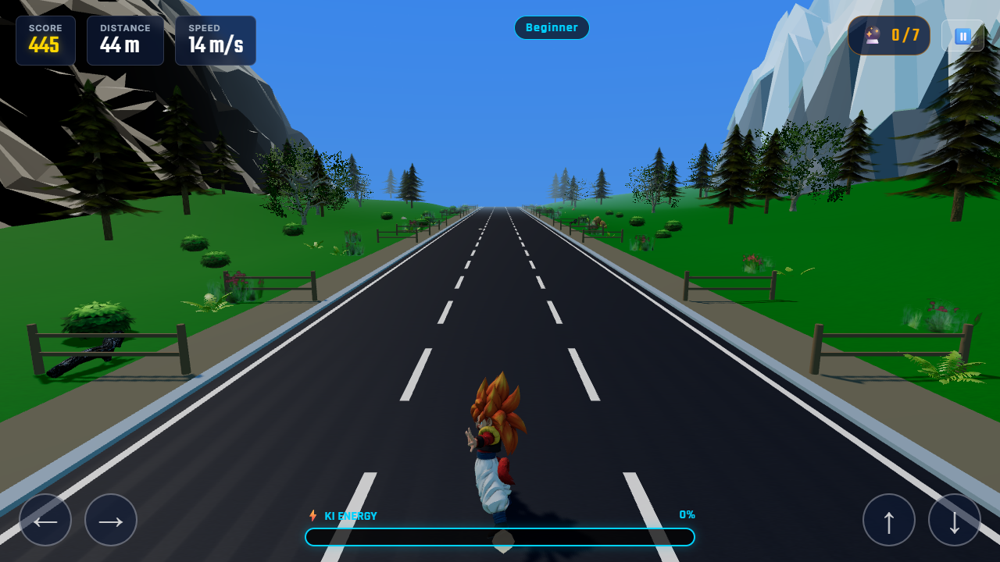
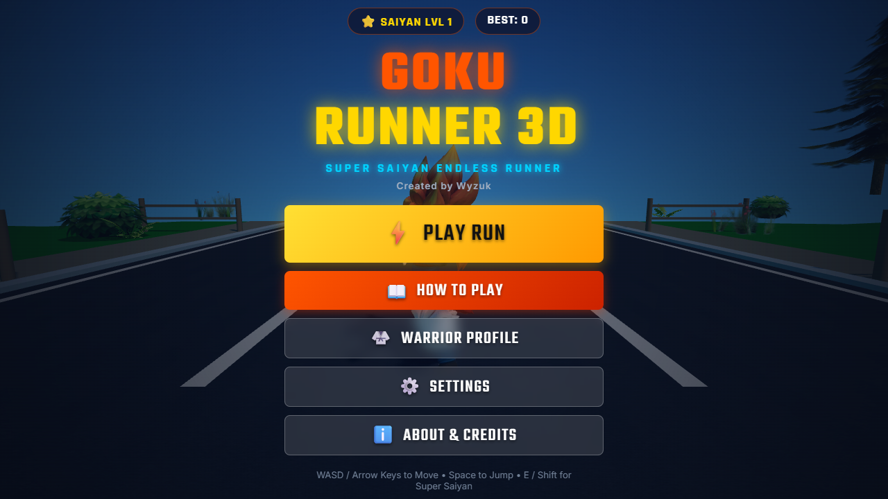
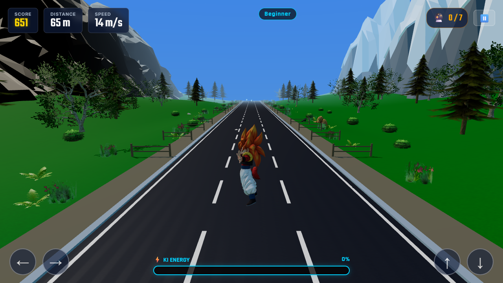
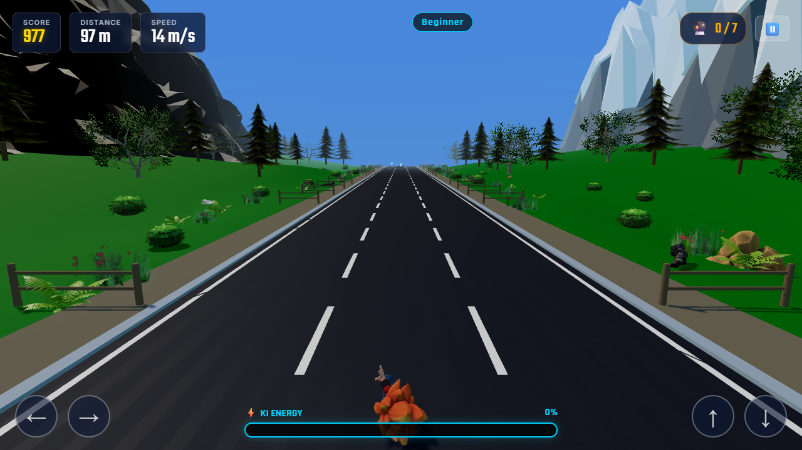
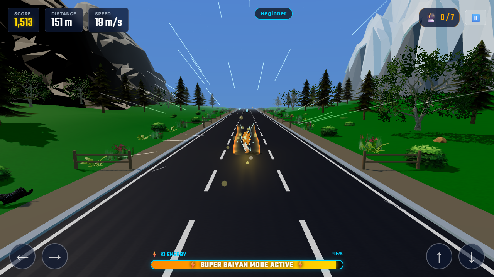
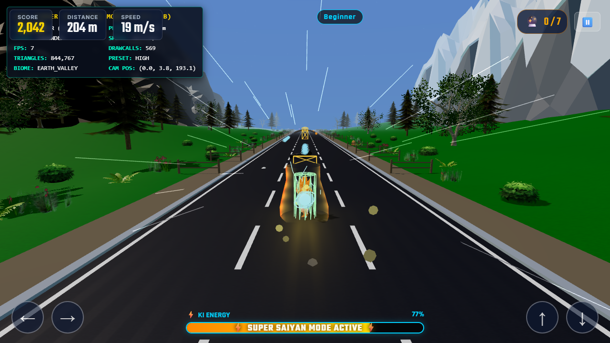

<div align="center">

# Wyzuk Goku Run

<p>A fast, responsive 3D endless runner built with Three.js and modern WebGL.</p>

[](https://opensource.org/licenses/MIT)
[](https://threejs.org/)
[](https://vitejs.dev/)
[](https://www.khronos.org/webgl/)
[](https://github.com/wyzuk)

<br/>



</div>

---

## Overview

**Wyzuk Goku Run** is a browser-based 3D endless runner inspired by anime aesthetics. Sprint across procedurally generated environments, react to dynamic obstacle patterns, collect Dragon Balls and Ki energy, and trigger Super Saiyan mode with real-time toon shaders and visual auras.

The game runs at a rock-solid 60 FPS in any modern web browser with zero external audio assets—sound effects and background music are synthesized in real time via the Web Audio API.

---

## Screenshots

<div align="center">

| Title Screen | Gameplay |
| :---: | :---: |
|  |  |

| Jump Mechanics | Slide Mechanics |
| :---: | :---: |
|  |  |

| Super Saiyan Mode | Alternate Skin (Gogeta) |
| :---: | :---: |
|  |  |

</div>

---

## Controls

The game supports simultaneous keyboard input schemes as well as touch controls for mobile devices.

| Action | Primary (WASD) | Secondary (Arrows) | Mobile |
| :--- | :---: | :---: | :---: |
| **Move Left** | `A` | `←` | Swipe Left / On-screen Button |
| **Move Right** | `D` | `→` | Swipe Right / On-screen Button |
| **Jump** | `W` | `↑` or `Space` | Swipe Up / On-screen Button |
| **Slide** | `S` | `↓` | Swipe Down / On-screen Button |
| **Super Saiyan** | `E` | `Shift` | `⚡` HUD Button |
| **Pause / Resume** | `Escape` | `P` | `⏸️` HUD Button |
| **Debug Monitor** | `F3` | `B` | — |

---

## Features

### Gameplay & World
- **Procedural Chunk Streaming**: Dynamic terrain generation with seamless pooling and recycling ahead of and behind the player.
- **Biomes & Lighting**: Varied landscape themes (valleys, rocky peaks, forests, sky bridges) with real-time day/night lighting transitions and fog.
- **Fair Hazard Generation**: Jump hurdles, overhead slide beams, and lane blockers designed with guaranteed escape routes at every speed tier.
- **Collectibles**: 7-Star Dragon Balls, Ki orbs, and power-ups (Flying Nimbus, Senzu Bean, Ki Surge, Magnetic Aura, Zenkai Boost).
- **Super Saiyan Transformation**: Ki-powered state granting invulnerability, speed boost, custom particle lightning, and audio pitch acceleration.

### Audio & Graphics
- **Real-Time Synth Audio**: 100% procedural sound effects and multi-track background music built directly with the Web Audio API.
- **Toon Cel-Shading**: Custom stepped ramp materials, particle bursts, and glowing aura shells.
- **Performance Budget**: Target draw calls under 80 per frame with geometry instancing and dynamic LOD.

---

## Getting Started

### Prerequisites
- [Node.js](https://nodejs.org/) (version 18 or higher)
- Modern browser with WebGL 2.0 support (Chrome, Firefox, Safari, Edge)

### Installation

1. **Clone the repository:**
   ```bash
   git clone https://github.com/wyzuk/goku-runner-3d.git
   cd goku-runner-3d
   ```

2. **Install dependencies:**
   ```bash
   npm install
   ```

3. **Start the local development server:**
   ```bash
   npm run dev
   ```
   Open `http://localhost:3000` in your browser.

4. **Build for production:**
   ```bash
   npm run build
   ```
   Production output is generated in the `dist/` directory.

---

## Project Structure

```
├── 3dmodels/              # 3D assets (GLB models, textures, previews)
├── docs/screenshots/     # In-game captures and documentation visuals
├── public/               # Public assets and texture maps
├── src/
│   ├── audio/            # Web Audio API procedural sound & music synth
│   ├── camera/           # Dynamic follow camera and shake system
│   ├── collectibles/     # Dragon Balls, Ki orbs, and power-up logic
│   ├── game/             # Main game loop, states, and event coordinator
│   ├── materials/        # Cel-shading shaders and procedural textures
│   ├── obstacles/        # Obstacle factory, collision boxes, and hazards
│   ├── player/           # Character models, skeletal rig, and animations
│   ├── progression/      # XP leveling, daily challenges, and achievements
│   ├── ui/               # M3-inspired HUD, menus, and settings modal
│   ├── utils/            # Asset loader, math helpers, and constants
│   ├── world/            # Procedural terrain chunks, skybox, and lighting
│   └── main.js           # Application entry point
├── index.html            # Web application entry page
├── package.json          # Project configuration and dependencies
└── vite.config.js        # Vite bundler configuration
```

---

## Tech Stack

| Component | Technology | Description |
| :--- | :--- | :--- |
| **3D Rendering** | Three.js (r187) | WebGL rendering engine, scene graph, shaders |
| **Bundler & Tooling** | Vite 5 | Fast HMR dev server and production Rollup bundler |
| **Audio Engine** | Web Audio API | Zero-dependency procedural synthesis |
| **Storage** | LocalStorage API | Client-side progression, high scores, and settings |
| **Language** | Vanilla JavaScript (ES Modules) | Clean, framework-free browser execution |

---

## License

This project is licensed under the [MIT License](LICENSE).

Developed with passion by **[Wyzuk](https://github.com/wyzuk)**.
